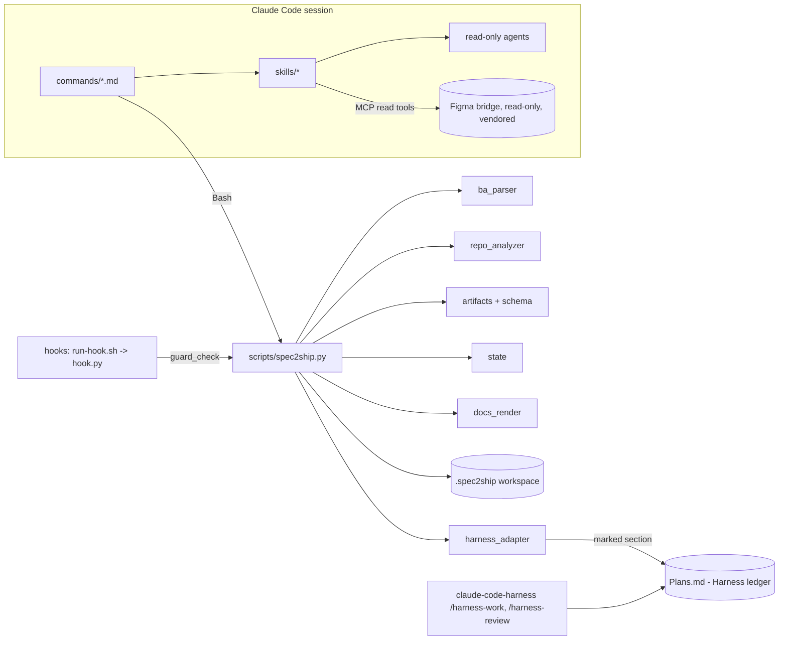

# Architecture

Spec2Ship splits work into a **deterministic core** (Python CLI, tested) and **semantic work** done by Claude
through skills/agents, whose outputs are JSON artifacts validated by the core.

## Modules (`scripts/s2s/`)

| Module | Responsibility |
|---|---|
| `cli.py` | subcommands, approval/intent logic, plan hash, guard check |
| `ba_parser.py` | MD/DOCX/PDF → IR (`blocks` with ids, page, line, section, tables); language & OCR detection |
| `figma.py` | URL parsing (file key, branch, node id → colon format), open-file name matching |
| `schema.py` | JSON Schema validation (`jsonschema` if installed, else built-in subset) |
| `artifacts.py` | cross-reference validation: citations vs IR, node ids vs captured context, coverage, orphans, cycles, evidence |
| `state.py` | state machine, transitions, approval, retries, blocking |
| `harness_adapter.py` | **only** place with Harness knowledge: detection, Plans.md path, render/renumber/merge, status read-back, drift |
| `repo_analyzer.py` | static repository analysis, secret-file skipping |
| `docs_render.py` | spec.md, RTM (json + md), delivery report |
| `preflight.py` | runtime/extractor/Harness/Figma-config/git checks |

## Key design decisions

- **Canonical JSON, generated Markdown.** `requirements.json`, `figma-mapping.json`, `tasks.json`, `rtm.json`,
  `verification.json` are the source of truth; `spec.md`, `Plans.md` preview, `rtm.md`, `report.md` are views.
  Developer edits to `spec.md` are detected (hash) and preserved.
- **Plan hash.** SHA-256 over requirements (progress statuses stripped; deferred/rejected kept because they change
  scope), mapping, tasks and spec.md. Approval binds to it; any later change blocks execution until re-approved.
- **Scope hash.** Over the Plans.md section rows excluding the Status column, so Harness marker updates
  (`cc:WIP`, `cc:完了 [hash]`) are allowed while scope edits are detected.
- **No duplicate engine.** Spec2Ship writes tasks into the Harness ledger and reads markers back; it never executes
  tasks. If Harness is absent/incompatible, preflight blocks.
- **Collision-free handoff.** Spec2Ship phases are renumbered after the highest existing Harness phase; the task map
  is stored in `state.json` and shown in the RTM.
- **Stdlib only.** No runtime dependencies; optional `pdftotext`/`pypdf`/`jsonschema` are used when present.
- **Templates in code.** Markdown views are rendered by `docs_render.py` rather than separate template files, so
  structure is tested; the blueprint's `templates/` directory was intentionally not created.
